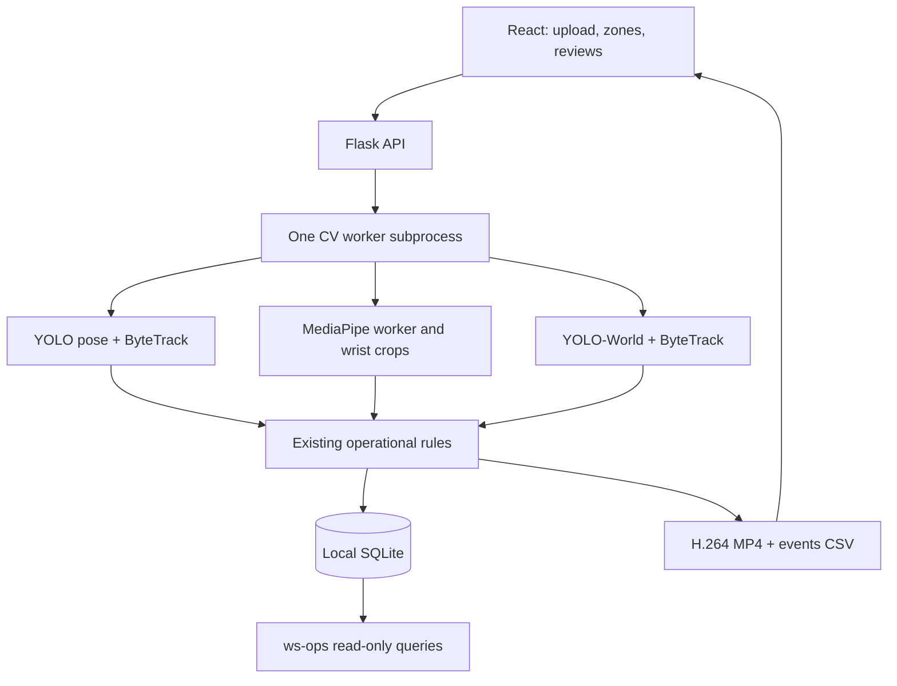

# WorkSight architecture

React is the only interface. Flask serves the built frontend and JSON API locally.
The worker calls `worksight.pipeline.process_video()` to run an analysis.

## Module boundaries

- `backend/app.py`: Flask factory, error handling, React static files.
- `backend/routes.py`: uploads, frame previews, zones, analysis imports and outputs.
- `backend/jobs.py`: single active worker process, persistent status and progress.
- `backend/worker.py`: invokes the CV pipeline; reports exceptions to SQLite.
- `worksight/storage.py`: SQLite schema and repository functions.
- `worksight/vision.py`: mandatory model preflight and cropped MediaPipe inference.
- `worksight/media.py`: video inspection and H.264 conversion.
- `worksight/rules.py`: existing zone and package rules.
- `worksight/pipeline.py`: frame loop, event intervals, annotations and CSV export.
- `dashboard/src/Workspace.jsx`: upload/import workflow and SVG zone editor.
- `dashboard/src/main.jsx`: existing reporting UI, slowdown ranking and timelines.

## Simple database and history

The six original data tables remain: videos, zones, detections, hand_detections,
package_detections and events. One additional `runs` table stores status, progress,
error and source-video ID. Each run gets a new UUID and its own `videos` analysis
record. Existing `video_id` foreign keys point at that analysis record. Therefore
the query helper still works with `--video-id` (or its alias `--run-id`) and old
results are preserved on reprocessing. Original uploads remain `ready` records.

The worker loads all models before altering detection data or creating output
files. It then writes bounded batches and reports frame progress. There is one
local API server process and one active worker process. Requests continue while
CV runs. Interrupted jobs are marked failed on server restart; start a new run
to retry. Checkpoint/resume and parallel chunks are not implemented.

Imports live under `data/dashboard_imports/<uuid>/` with their metadata. They do
not fabricate frame-level SQLite records. CSV imports support exported review
counts/timelines, but cannot provide exact per-frame staffing, package counts or
calibrated utilisation. Throughput is deliberately deferred.

## API

| Endpoint | Purpose |
| --- | --- |
| GET /api/health | Package/weight availability (actual inference checked per run) |
| GET, POST /api/videos | List records or upload an original video |
| GET /api/videos/:id/frame?seconds=0 | JPEG preview |
| GET, PUT /api/videos/:id/zones | Read/save both normalized polygons |
| POST /api/videos/:id/runs | Start a run with analysis_fps |
| GET /api/runs/:id | Status, progress, errors |
| GET /api/analyses/:id | Completed analysis metadata and CSV events |
| GET /api/analyses/:id/video | Range-aware annotated-video streaming |
| GET /api/analyses/:id/csv | Events CSV download |
| POST /api/imports | Multipart video + csv pair |
| GET /api/imports/:id | Imported pair metadata and events |
| GET /api/imports/:id/video or /csv | Imported evidence files |

Add `?download=1` to a video URL to download it. Upload request limit is 2 GiB,
including multipart overhead. Files are streamed from request temporary storage
to their unique folder. Flask runs locally at 127.0.0.1:5001. Vite proxies /api
there during development. Production video routes use conditional/range responses.

## CSV v2

Legacy columns remain: Time, Track, Signal, Duration (s), Confidence, Evidence rule,
Interpretation. Additive columns: Schema version, Run ID, Video, Event ID,
Start seconds, End seconds, Start frame, End frame, Package track ID, Zone.
Numeric timestamps preserve subsecond precision; Time is a display label.
End seconds is the exclusive interval boundary. End frame is the last sample
frame inferred from end_ms and source FPS. Package track ID and Zone may be blank
when the event does not identify them. Confidence is person-box detection
confidence, not a probability that an interpretation is true. Headers are written
even with zero events. The importer accepts legacy formatted times and numeric
seconds, validates finite values and checks event bounds against video duration.

## Model limitations

ByteTrack runs separately for people and packages; MediaPipe hands are associated
with nearby person tracks. Workers can receive new IDs after occlusion. A package
track is not a completed unload. Model availability and zero detections are distinct.
Hands/packages can be missed, even when models initialise correctly. The validation
script fails its evidence check if representative landmarks/tracks are absent.
New staffing mismatch events and Claude queries both count same-frame
wrist or fingertip cues in the conveyor zone. Older exports keep their
recorded events. Fixed-window queries and persisted event intervals use
different time groupings.
